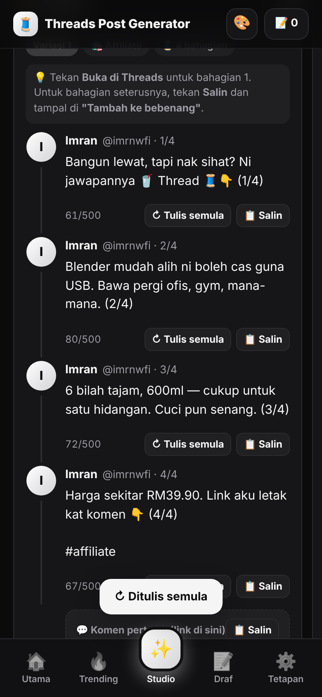

# 🧵 Threads Post Generator

Laman web (boleh dipasang sebagai app) untuk info terkini **💰 Kewangan**, **🏛️ Bantuan Kerajaan** & **📲 E-Wallet** — jana post & bebenang Threads dengan AI, **Kad Info** (infografik untuk Story/Status), ayat affiliate Shopee, kalendar kandungan & penjejak komisen.

👉 **Buka:** https://imrnwfi.github.io/threads-autopost/

App ini **tidak post ke Threads**. Anda semak draf, tekan **Buka di Threads** (Threads dibuka dengan teks siap diisi), dan post sendiri.

<p>
  
  
</p>

## Penyedia AI

| Penyedia | Kos | Nota |
|---|---|---|
| Google Gemini | Percuma (had kecil) | Boleh baca web / link |
| Groq ⭐ | Percuma (had harian besar) | [console.groq.com/keys](https://console.groq.com/keys) — tiada carian web |
| OpenRouter | Model percuma (±50/hari) | [openrouter.ai/settings/keys](https://openrouter.ai/settings/keys) |
| Anthropic Claude | Berbayar | Boleh baca web / link |

**Kunci sandaran:** Tetapan → 🛟 Kunci sandaran. Bila penyedia utama kehabisan kuota, app terus guna kunci sandaran (cth. Gemini utama + Groq sandaran).

## Pembaca link Shopee

Supaya app boleh **baca terus** nama, harga & penerangan produk daripada link Shopee (termasuk link pendek `s.shopee.com.my`), pasang pembaca link percuma di Cloudflare (±5 minit, sekali sahaja):

1. Daftar / log masuk di [dash.cloudflare.com](https://dash.cloudflare.com) (percuma).
   - **Cara paling mudah (tanpa salin kod):** **Workers & Pages → Create → Connect GitHub** → pilih repo `threads-autopost` → nama projek `shopee-reader` → *Advanced settings* → **Root directory: `worker`** → **Deploy**. Kemudian terus ke langkah 4.
2. **Workers & Pages → Create → Create Worker** → beri nama, cth. `shopee-reader` → **Deploy**.
3. Tekan **Edit code**, padam semua kod contoh, tampal isi fail [`worker/shopee-reader.js`](worker/shopee-reader.js) → **Deploy**.
4. Salin URL worker (cth. `https://shopee-reader.nama-anda.workers.dev`).
5. Dalam app: **Tetapan → 🔗 Pembaca link Shopee** → tampal URL → **Simpan** → **Uji** dengan satu link produk.

Selepas itu, dalam Studio → Affiliate: tampal link → tekan **Jana sekarang**. App baca produk dan terus tulis ayat (link masuk komen pertama).

Tanpa pembaca link, app cuba minta AI baca link (Gemini *URL context* / Claude *web fetch*). Cara ini mungkin dihadkan pada kunci Gemini percuma; jika gagal, app teka nama daripada link dan minta anda lengkapkan.

## Ciri-ciri

### ✍️ Menulis
- **Jana post / bebenang** (2–8 bahagian) dalam **Bahasa Melayu** — santai, baku atau loghat (Utara, Kelantan, Sabah, Sarawak).
- **Skor hook** 1–10 dengan tips & 3 hook alternatif.
- **Gaya tulisan saya** — tampal post lama, AI analisis & tiru gaya anda.
- **Bank hook** — 50+ templat ayat pembuka ikut kategori.
- **Tukar sekali tekan:** Pendek, Lucu, Yakin, ±Emoji, Hook kuat, CTA, tukar bahasa — dengan **↩︎ Asal**.
- **Tulis semula satu bahagian** sahaja dalam bebenang.
- **Siri kandungan** (#1, #2…) — AI pilih subtopik baharu yang tak berulang.

### 🛍️ Affiliate
- Tampal link Shopee → **✨ Isi automatik** (AI cari nama, harga & kelebihan).
- **Banyak produk dalam satu bebenang** (sehingga 6) — semua link dalam komen pertama.
- **Simpanan produk** + **penjejak klik, jualan & komisen** (🏆 produk paling laku).
- **Musim jualan & perayaan** (11.11, 12.12, Payday, Raya, CNY, Black Friday…) dengan idea kandungan.
- **Kongsi terus dari app Shopee** ke app ini (Android, selepas dipasang).

### 🗂️ Kategori (hanya 3 topik)

| Kumpulan | Subkategori |
|---|---|
| 💰 **Kewangan** | 📈 Pelaburan · 🎯 Tips Labur · 📱 App Pelaburan · 🐷 Tips Simpan & Jimat · 🏦 Bank & Bank Digital · 💻 Duit Tambahan |
| 🏛️ **Bantuan Kerajaan** | 💵 Bantuan Tunai (STR, SARA) · ⛽ Subsidi (BUDI95) · 🎓 Pendidikan & Belia · 📜 Belanjawan & Program |
| 📲 **E-Wallet** | 🎁 Promo & Cashback · 🆓 Duit & Topup Percuma · 💳 Tips & Berita E-Wallet · 🚨 Amaran Penipuan |

Hanya berita **Bahasa Melayu** daripada media Malaysia; topik di luar kategori ini ditapis keluar secara automatik.

### 🖼️ Kad Info
- Maklumat ringkas versi gambar: tajuk, angka penting, 3–5 poin, nota & sumber.
- Saiz **9:16 (Story/Status)**, 4:5 & 1:1 · 6 gaya (ikut kategori, tema, gelap, cerah, kertas, sunset).
- AI boleh **sahkan fakta dengan carian web** (Gemini berbayar / Claude). Kad tanda ⚠️ jika fakta tidak dapat disahkan.
  - ℹ️ API key Gemini **percuma** tiada kuota carian Google — app akan jana tanpa carian web secara automatik.
- **Kongsi terus** ke WhatsApp Status / Instagram Story, muat turun PNG, salin kapsyen, simpan ke Draf.

### 🔥 Topik terkini
- Google Trends, Google News (6 kategori + berita utama), YouTube Trending, forum Lowyat & Reddit (pilihan) — dikemas kini **setiap jam** oleh GitHub Actions.
- **🚀 Meletup** — topik baharu yang naik mendadak dalam 1–3 jam.
- **Kategori sendiri** dengan kata kunci anda (cth. Kereta, Parenting).

### 🗓️ Perancangan & insight
- **Kalendar** — pelan mingguan (cth. Isnin kewangan, Rabu affiliate) + jadual draf + "Hari ini" di Utama.
- **Insight masa terbaik** — isi suka/balasan/kongsi selepas post, app cadangkan masa, hari & format terbaik.
- **Streak harian 🔥** & sasaran post mingguan.

### 🎨 Pengalaman
- Onboarding 3 langkah, 8 tema, ikon SVG, saiz teks boleh laras.
- **Pratonton dalam bingkai telefon**, animasi "AI sedang menaip", confetti 🎉.
- **Salin seterusnya** untuk bebenang (1 → 2 → 3 → komen).
- Draf: **cari & tapis**, **label warna**, **leret** kiri (padam) / kanan (sudah post), **buat asal**.
- **Kad gambar** (4:5, 1:1, 9:16) — muat turun atau kongsi terus.
- **PWA** — pasang di skrin utama, boleh dibuka luar talian.
- **Kemas kini app** — butang "Kemas kini" bila ada versi baharu (dengan nota apa yang baru), atau kemas kini automatik bila app dibuka semula / ditutup.
- **Sync Google Drive** antara telefon & laptop.

## Cara guna

1. Buka laman di atas. Ikut 3 langkah onboarding (nama → tema → API key).
   - Gemini: dapatkan key percuma di [Google AI Studio](https://aistudio.google.com/apikey).
2. **Topik viral:** Trending → **✨ Jana post**. **Affiliate:** Studio → 🛍️ Affiliate → tampal link → **✨ Isi automatik** → **Jana sekarang**.
3. Edit → **Buka di Threads** → post. Bebenang: guna **Salin seterusnya**. Affiliate: salin **Komen pertama** (ada link).
4. Tekan **✓ Sudah post** (atau leret draf ke kanan).

### Pasang sebagai app
- **Android (Chrome):** menu ⋮ → *Pasang aplikasi*. Selepas itu, dalam app Shopee tekan **Kongsi → Threads Gen**.
- **iPhone (Safari):** Kongsi □↑ → *Add to Home Screen*.

## Sync Google Drive

Data disimpan dalam folder tersembunyi (appDataFolder) Google Drive anda sendiri. API key **tidak** di-sync.

1. Buka [Google Cloud Console](https://console.cloud.google.com/) → cipta projek baharu.
2. **APIs & Services → Library** → aktifkan **Google Drive API**.
3. **Google Auth Platform → Branding**: isi nama app & emel. **Audience**: pilih *External*, tambah emel anda sebagai **Test user**.
4. **Clients → Create client** → jenis **Web application** → *Authorized JavaScript origins*: `https://imrnwfi.github.io` → **Create**.
5. Salin **Client ID** (`…apps.googleusercontent.com`) → tampal di **Tetapan → Sync** → **Sync sekarang**.

## YouTube Trending (pilihan)

1. Google Cloud Console → aktifkan **YouTube Data API v3** → **Credentials → Create API key**.
2. Repo GitHub → **Settings → Secrets and variables → Actions → New repository secret** → nama `YOUTUBE_API_KEY`.
3. **Actions** → jalankan workflow sekali.

## Forum Lowyat (pilihan)

Tetapkan URL suapan RSS forum Lowyat di repo GitHub → **Settings → Secrets and variables → Actions → Variables → New repository variable** → nama `LOWYAT_RSS`.

## Reddit (pilihan)

Reddit menyekat kebanyakan pelayan GitHub Actions, jadi ia dimatikan secara default. Untuk cuba: tambah repository variable `ENABLE_REDDIT` = `1`.

## Cara ia berfungsi

```
GitHub Actions (setiap jam)
  └─ scripts/fetch-trends.mjs → Google Trends/News, Reddit, Lowyat, YouTube
       └─ bandingkan dengan larian lepas (topik meletup) → site/data/trends.json
            └─ deploy ke GitHub Pages bersama site/

Browser / app anda
  ├─ data/trends.json
  ├─ API AI terus (Gemini / Claude / serasi OpenAI) guna key anda
  ├─ localStorage (draf, produk, siri, pelan)
  └─ Google Drive appDataFolder (sync, pilihan)
```

## Pasang sendiri (fork)

1. Fork repo ini → **Settings → Pages → Source: GitHub Actions**.
2. **Actions** → jalankan **"Kemas kini trending & deploy ke GitHub Pages"**.
3. Untuk sync, gunakan origin GitHub Pages anda sendiri pada langkah 4 di atas.

> GitHub mematikan workflow berjadual dalam repo awam selepas 60 hari tanpa aktiviti. Jika trending berhenti dikemas kini, aktifkan semula di tab **Actions**.

```bash
npm install
npm run dev      # ambil trending + buka http://localhost:3000
npm test
```

## Struktur projek

```
site/index.html, style.css, manifest.webmanifest, sw.js, icons/
site/js/app.js        # Navigasi, Utama, Trending, Studio, kad pratonton, Draf
site/js/pages.js      # Kalendar, Produk, Siri, Insight, Bank Hook, Tetapan
site/js/ai.js         # Prompt & panggilan AI
site/js/data.js       # Bank hook, musim jualan, pelan, label
site/js/store.js      # localStorage + gabung data
site/js/sync.js       # Sync Google Drive
site/js/imagecard.js  # Kad gambar (canvas)
site/js/icons.js      # Ikon SVG
lib/trends.js         # Cari & skor topik viral
scripts/fetch-trends.mjs
```

## Tips

- Untuk **bantuan kerajaan** dan **kewangan**, sentiasa semak fakta di laman rasmi — AI hanya guna tajuk/ringkasan berita.
- Harga produk dari "Isi automatik" mungkin berubah — semak di Shopee sebelum post.

## Lesen

MIT
