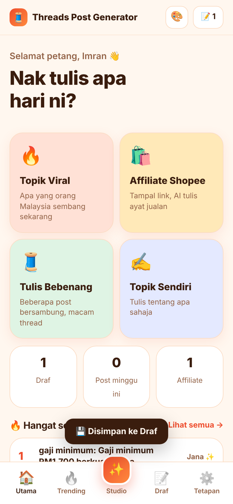

# 🧵 Threads Post Generator

Laman web untuk **cari topik viral Malaysia**, **tulis ayat affiliate Shopee** dan **jana bebenang (thread) Threads** dengan AI.

👉 **Buka:** https://imrnwfi.github.io/threads-autopost/

App ini **tidak post ke Threads**. Anda semak draf, tekan **Buka di Threads** (Threads dibuka dengan teks siap diisi), dan post sendiri.

<p>
  
  
</p>

## Ciri-ciri

| | |
|---|---|
| 🔥 **Topik viral** | Google Trends (MY) + Google News (BM & English), dikemas kini **setiap jam** oleh GitHub Actions. 6 kategori: kewangan, makanan, voucher, bantuan kerajaan, info viral, AI. |
| 🛍️ **Affiliate Shopee** | Tampal link → **✨ Isi automatik** (AI cari nama, harga & kelebihan produk) → pilih gaya ayat (Wajib ada, Bawah bajet, Masalah→solusi, POV, Senarai, Pendapat jujur, Promo). Link diletak dalam **komen pertama**, dengan pilihan #affiliate. |
| 🧵 **Bebenang** | 2–8 bahagian bersambung (hook → isi → CTA), penomboran 1/n pilihan, **tulis semula satu bahagian** sahaja. |
| 👀 **Pratonton macam Threads** | Gambar profil, nama & garis bebenang. Leret untuk tukar variasi. |
| 🎨 **8 tema** | Ikut peranti, Threads Gelap/Cerah, Kreator Ceria, Studio Pro, Pastel Manis, Neon Malam, Laut Biru. Tekan 🎨 untuk tukar bila-bila masa. |
| 📝 **Draf** | Simpan, sunting, Belum post / Sudah post, eksport/import JSON. |
| 🤖 **Pilihan AI** | Google Gemini (ada tier percuma), Anthropic Claude, atau API serasi OpenAI. |
| 🔒 **Privasi** | Tiada pelayan. API key & draf disimpan dalam browser anda sahaja. |

## Cara guna

1. Buka laman di atas (Chrome/Safari, telefon atau komputer).
2. **Tetapan** → pilih penyedia AI → tampal API key → Simpan.
   - Gemini: dapatkan key percuma di [Google AI Studio](https://aistudio.google.com/apikey).
3. **Topik viral:** tab Trending → **✨ Jana post**.
   **Affiliate:** Studio → 🛍️ Affiliate → tampal link Shopee → **✨ Isi automatik** → **Jana sekarang**.
4. Edit jika perlu → **🧵 Buka di Threads** → post.
   - Bebenang: bahagian 2 dan seterusnya → **Salin** → tampal di "Tambah ke bebenang".
   - Affiliate: salin **Komen pertama** (ada link) → komen pada post anda.
5. Tekan **✓ Sudah post**.

## Cara ia berfungsi

```
GitHub Actions (setiap jam)
  └─ scripts/fetch-trends.mjs → ambil RSS Google Trends & Google News
       └─ site/data/trends.json
            └─ deploy ke GitHub Pages bersama site/ (HTML/CSS/JS)

Browser anda
  ├─ baca data/trends.json
  ├─ panggil API AI terus (guna key anda)
  └─ simpan draf dalam localStorage
```

## Pasang sendiri (fork)

1. Fork repo ini.
2. **Settings → Pages → Build and deployment → Source: GitHub Actions**.
3. **Actions** → aktifkan workflow → jalankan **"Kemas kini trending & deploy ke GitHub Pages"** (Run workflow).
4. Laman anda: `https://<username>.github.io/<nama-repo>/`

> Nota: GitHub mematikan workflow berjadual dalam repo awam selepas 60 hari tanpa aktiviti. Jika trending berhenti dikemas kini, buka tab **Actions** dan aktifkan semula.

### Jalankan di komputer

```bash
npm install
npm run dev      # ambil trending + buka http://localhost:3000
npm test
```

## Struktur projek

```
site/                     # Laman web (index.html, app.js, ai.js, style.css)
lib/trends.js             # Logik cari & skor topik viral
scripts/fetch-trends.mjs  # Dijalankan oleh GitHub Actions
.github/workflows/pages.yml
test/
```

## Tips

- Untuk **bantuan kerajaan** dan **kewangan**, sentiasa semak fakta di laman rasmi sebelum post — AI hanya guna tajuk/ringkasan berita.
- Draf disimpan per browser. Guna **Eksport/Import** di Tetapan untuk pindah ke peranti lain.

## Lesen

MIT
